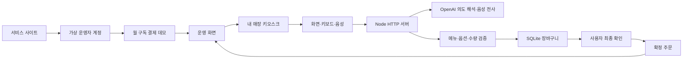

# 구현 구조

## 두 서비스 경험

서비스 소개·가입·요금제·구독 데모와 고객용 키오스크는 화면과 이용 목적이 구분됩니다. 같은 서버를 이용해 가상 운영자의 매장과 해당 매장의 주문을 연결합니다.

## 실행 환경

- Node.js 24.13 이상, ES modules
- 내장 `node:http`, `node:sqlite`, `node:crypto`, `fetch`
- 프런트엔드는 HTML/CSS/JavaScript 모듈. 외부 스크립트·폰트·분석 도구를 로드하지 않음
- SQLite WAL, prepared statements, 주문 확정·계정 생성 등에 트랜잭션 사용
- 별도 npm 패키지 설치·번들 빌드 없이 실행

## 기술적 차별화와 실제 동작

### 입력 전환의 연속성

화면과 AI 해석은 같은 서버 장바구니에 동일한 제한된 연산을 적용합니다. 보기·듣기 설정은 UI 설정이며 주문 상태와 분리됩니다. 브라우저 새로고침 후에도 유효한 세션이면 장바구니를 다시 가져옵니다.

### 맥락을 이용한 부분 수정

Responses API에 메뉴와 현재 장바구니를 제공하고 JSON Schema의 제한된 연산으로 해석합니다. `split_temperature`는 두 잔 중 한 잔의 온도만 바꿉니다. 임의의 서버 코드나 가격을 모델이 실행·설정하지 않습니다.

### 언어와 표시 크기

태블릿 테두리 안에서 메뉴와 주문 목록이 각각 스크롤됩니다. 한국어·영어·일본어·중국어 UI와 메뉴명을 제공하며, 읽어주기는 선택한 언어와 브라우저에 설치된 음성을 사용합니다. 글자 크기 90–160%, 이미지 크기 75–150%를 독립적으로 조절하고 브라우저에 저장합니다.

명확한 화면 전용 문장(“글씨 크게 보여줘”, “사진 작게”)은 클라이언트에서 즉시 처리합니다. 음성도 전사 뒤 같은 표시 설정 해석기를 사용합니다. 주문과 표시 요청이 섞이면 Responses API의 제한된 `presentation` 필드와 주문 연산을 함께 사용합니다. 표시 설정은 가격·수량을 변경하지 않으며, 늦게 도착한 AI 응답이 더 최근의 수동 표시 설정을 덮어쓰지 않게 별도 UI 버전을 비교합니다.

### 잔별 추가 옵션과 가격

커피 메뉴에 헤이즐넛 시럽(데모 가격 잔당 500원)을 등록했습니다. 장바구니의 `addons`는 옵션 ID 목록이며, 상품별 허용 옵션을 서버가 검증합니다. 온도와 옵션이 모두 같은 줄만 합칩니다. `addons` 연산의 수량을 지정하면 해당 수량만 분리해 옵션을 바꾸고, 온도 변경은 기존 옵션을 보존합니다. 가격과 최종 합계는 서버 메뉴에서 다시 계산하고 확인 화면과 운영 화면에도 선택한 시럽을 전달합니다.

### 홈페이지 음성 시연

`public/media/voice-order-demo.mp4`는 38초 H.264/AAC 영상입니다. macOS 한국어 합성 음성을 실제 전사 API로 확인한 뒤, 그 인식 문장을 실제 UI에서 전송해 바뀐 화면을 캡처하고 편집했습니다. 실제 사람의 마이크 녹화나 실시간 응답 속도 측정 자료가 아닙니다. 자막 VTT와 포스터를 제공하고 자동 재생 없이 네이티브 컨트롤·장면 이동을 지원합니다. 서버는 영상의 HEAD·단일 바이트 범위 요청을 처리해 재생과 탐색을 지원합니다.

### 검증과 충돌 처리

서버가 상품 ID, 옵션, 정수 수량과 판매 가능 여부를 검증합니다. `revision`이 다른 변경은 409로 거절해 오래된 음성 결과가 새로운 화면 선택을 덮어쓰지 않도록 합니다. 여러 연산 중 하나라도 유효하지 않으면 기존 장바구니를 유지합니다.

### 최종 확인과 중복 방지

AI는 확인 화면을 제안할 수 있지만 주문을 확정하지 못합니다. 최종 확인 버튼에서 현재 금액과 revision을 다시 검증합니다. 동일 세션·revision의 중복 요청은 기존 주문을 돌려주며 주문과 장바구니 변경은 한 트랜잭션으로 처리합니다.

## 계정과 데이터 경계

- 운영자와 고객은 별도 세션 쿠키를 사용
- 쿠키는 HttpOnly·SameSite=Strict이며 서버에는 토큰의 SHA-256 해시만 저장
- 운영자 주문·메뉴·도움 요청은 세션의 매장 ID로 범위 제한
- 쿠키 없는 고객도 키오스크 체험 세션을 발급받아 이용
- 가상 매장 프리셋만 가입 입력으로 허용. 실명·이메일·전화·비밀번호 입력란 없음
- 원시 음성과 대화 원문을 파일·DB·요청 로그에 저장하지 않음
- 음성 전사는 동의 안내 후 최대 20초 녹음, 메모리의 파일을 OpenAI에 전송
- 전사 결과는 입력창에서 먼저 확인·수정하고 사용자가 다시 전송
- `store:false`로 Responses API 호출. 외부 제공업체의 데이터 처리 정책은 별도 적용

## 사용량 관리

세션·IP별 요청 제한, 일별 AI 요청 총량 제한, 본문·음성 파일 크기 제한과 외부 요청 타임아웃을 둡니다. 일별 한도는 `OPEN_KIOSK_DAILY_AI_LIMIT`으로 설정하며 기본값은 200요청입니다. 음성 전사와 주문 해석은 각각 한 요청으로 계산합니다. 토큰 사용량·실제 비용의 상한을 보장하는 과금 시스템은 아닙니다.

## 한계

가상 계정의 세션 연결은 정식 사용자 인증이나 계정 복구를 대체하지 않습니다. 실제 장애인 이용 검증·키오스크 하드웨어 접근성 인증·POS·카드 결제는 포함하지 않습니다.

공식 구현 참고: [Structured Outputs](https://developers.openai.com/api/docs/guides/structured-outputs?api-mode=responses), [음성 전사](https://developers.openai.com/api/docs/guides/speech-to-text), [사용 버전 Node SQLite](https://nodejs.org/download/release/v24.13.0/docs/api/sqlite.html).
