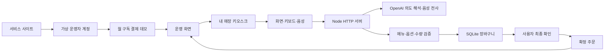

# 구현 구조

## 두 서비스 경험

서비스 소개·가입·요금제·구독 데모와 고객용 키오스크는 화면과 이용 목적이 구분됩니다. 같은 서버를 이용해 가상 운영자의 매장과 해당 매장의 주문을 연결합니다.

## 실행 환경

- Node.js 24.13 이상, ES modules
- 내장 `node:http`, `node:sqlite`, `node:crypto`, `fetch`
- 프런트엔드는 HTML/CSS/JavaScript 모듈. 외부 스크립트·폰트·분석 도구를 로드하지 않음
- SQLite WAL, prepared statements, 주문 확정·계정 생성 등에 트랜잭션 사용
- 별도 npm 패키지 설치·번들 빌드 없이 실행

## 기술적 차별화와 실제 동작

### 입력 전환의 연속성

화면과 AI 해석은 같은 서버 장바구니에 동일한 제한된 연산을 적용합니다. 보기·듣기 설정은 UI 설정이며 주문 상태와 분리됩니다. 브라우저 새로고침 후에도 유효한 세션이면 장바구니를 다시 가져옵니다.

### 맥락을 이용한 부분 수정

Responses API에 메뉴와 현재 장바구니를 제공하고 JSON Schema의 제한된 연산으로 해석합니다. `split_temperature`는 두 잔 중 한 잔의 온도만 바꿉니다. 임의의 서버 코드나 가격을 모델이 실행·설정하지 않습니다.

### 언어와 표시 크기

태블릿 테두리 안에서 메뉴와 주문 목록이 각각 스크롤됩니다. 한국어·영어·일본어·중국어 UI와 메뉴명을 제공하며, 읽어주기는 선택한 언어와 브라우저에 설치된 음성을 사용합니다. 글자 크기 90–160%, 이미지 크기 75–150%를 독립적으로 조절하고 브라우저에 저장합니다.

명확한 화면 전용 문장(“글씨 크게 보여줘”, “사진 작게”)은 클라이언트에서 즉시 처리합니다. 음성도 전사 뒤 같은 표시 설정 해석기를 사용합니다. 주문과 표시 요청이 섞이면 Responses API의 제한된 `presentation` 필드와 주문 연산을 함께 사용합니다. 표시 설정은 가격·수량을 변경하지 않으며, 늦게 도착한 AI 응답이 더 최근의 수동 표시 설정을 덮어쓰지 않게 별도 UI 버전을 비교합니다.

### 잔별 추가 옵션과 가격

커피 메뉴에 헤이즐넛 시럽(데모 가격 잔당 500원)을 등록했습니다. 장바구니의 `addons`는 옵션 ID 목록이며, 상품별 허용 옵션을 서버가 검증합니다. 온도와 옵션이 모두 같은 줄만 합칩니다. `addons` 연산의 수량을 지정하면 해당 수량만 분리해 옵션을 바꾸고, 온도 변경은 기존 옵션을 보존합니다. 가격과 최종 합계는 서버 메뉴에서 다시 계산하고 확인 화면과 운영 화면에도 선택한 시럽을 전달합니다.

### 홈페이지 음성 시연

`public/media/voice-order-demo.mp4`는 31초 H.264/AAC 영상입니다. `/kiosk?demo=voice`에서 공개된 합성 음성 MP3 네 개를 순서대로 재생하고, 같은 오디오 바이트를 실제 전사 API와 주문 해석에 넣어 자동 반영하는 화면을 연속 캡처했습니다. 입력창을 채우거나 보내기 버튼을 누르지 않았습니다. 음성 파형은 재생 오디오의 Web Audio 분석 결과이며, 인식 문장은 읽기 전용 안내로 표시됩니다. 처음부터 연속 시연 버튼으로 네 음성을 자동 재생합니다. 첫 문장으로 글자와 그림을 모두 140%로 키운 뒤 같은 페이지·장바구니·화면 크기에서 주문을 이어갑니다. 시연 화면은 고정된 1370×672 크기를 사용하고 음성 안내 영역도 크기를 유지해 중간에 메뉴가 밀리지 않도록 했습니다.

마이크 입력과 합성 음성 시연은 `voice-flow.js`의 동일한 전사 → 표시 설정 또는 주문 해석 흐름을 사용합니다. 홈페이지 영상은 이전 버전의 합성 음성 주문 시연이며, 실제 마이크 발화 감지나 다국어 전환 시연을 포함하지 않습니다. 영상은 중간 장면·처리 대기 시간을 생략하지 않았으며 마지막 확인 화면만 잠시 더 유지합니다. 자막·포스터·장면 시각과 영상의 바이트 범위 요청 지원은 유지합니다. 실제 사람의 마이크 녹화가 아닙니다.

### 진입 준비와 자동 발화 감지

일반 `/kiosk`는 언어·안내 읽어주기·음성 전송 동의를 한 준비 화면에 표시합니다. ‘음성·화면 함께 시작’에서 브라우저 마이크 권한을 요청하고 AudioWorklet을 연결합니다. ‘화면으로 시작’은 마이크 없이 같은 메뉴판을 사용합니다. 준비 전에는 마이크를 열지 않습니다. 권한 거부·장치 없음·기능 미지원은 준비 화면에서 알리고 화면 주문으로 이어갈 수 있습니다.

`SpeechDetector`는 로컬 PCM 에너지와 적응형 잡음 기준으로 발화 후보를 나눕니다. 짧은 클릭을 걸러내고 약 450ms의 앞부분을 보존하며, 발화 뒤 약 2초 무음 또는 20초 구간 제한에서 WAV를 만듭니다. 조용한 대기 구간은 서버에 보내지 않습니다. 사람·화자 식별이나 학습 기반 음성 분류기가 아니므로 음악·주변 대화·약한 발화에 대한 실제 환경 검증이 필요합니다.

한 구간을 해석하는 동안 다음 입력은 감지하지 않습니다. 안내 읽어주기 중과 끝난 뒤 450ms, 대화 일시정지, 숨겨진 탭, 허용하지 않은 대화상자에서도 버퍼를 비웁니다. 메아리 제거·잡음 억제 제약을 요청하지만 실제 적용은 브라우저·장치에 따릅니다. 연결 해제·권한 요청 중 화면 이탈·페이지 종료 시 스트림과 AudioContext를 정리합니다. 연속 오류 3회 또는 사용 한도·연결 오류에서는 대화를 쉬고 화면 주문을 유지합니다.

### 언어와 비시각적 주문

국기는 언어명과 함께 표시합니다. 한국어·가나·한자·영어 문장 등의 문자 규칙으로 네 지원 언어 중 하나를 선택하고 UI·메뉴명·장바구니·안내 음성 언어를 함께 맞춥니다. 짧은 숫자나 모호한 상품명 하나는 현재 언어를 유지합니다. 영어 외 라틴 문자 언어나 가나 없는 일본어 등은 정확히 구분하지 못할 수 있고 수동 선택을 제공합니다. 전사 API에는 특정 언어를 강제하지 않습니다.

안내 읽어주기는 준비 화면에서 기본 선택하며 스크린리더와 중복될 때 끌 수 있습니다. 안내 문장을 OpenAI 음성 생성 API에 보내 해당 언어 MP3를 재생하고, 연결 실패 시 설치된 해당 언어의 브라우저 음성을 대안으로 사용합니다. 두 방식 모두 실패하면 상태 안내를 제공합니다. 준비 화면에 AI 합성 음성임을 표시합니다. 서버의 합성 MP3는 최대 16개·5분 동안 메모리에만 재사용하며 파일에 저장하지 않습니다. ‘메뉴 읽어줘’, ‘내 주문 읽어줘’, ‘다시 말해줘’와 추천 순번·온도·상품 수량·시럽·닫기·확인 응답을 지원합니다. 확인 화면이 열린 뒤 별도의 긍정·확정 응답이 있어야 주문하며, ‘담아줘’를 최종 확정으로 해석하지 않습니다. 실제 음식값 청구는 없습니다.

대화상자는 제목에 포커스를 두고 기본 키보드 이동을 유지합니다. Alt+M은 대화 쉬기·계속, Alt+R은 다시 듣기, Alt+O는 주문 확인입니다. 보기 변경과 메뉴 탐색은 각각 버전을 비교해 늦은 AI 결과가 더 최근 수동 선택을 덮어쓰지 않게 합니다. 최근 네 발화는 브라우저 메모리에서 길이를 제한해 해석에 전달하고 수동 주문 변경·체험 종료 시 비웁니다. 서버에 대화 원문을 저장하지 않습니다.

구현 참고: [OpenAI 음성 전사](https://developers.openai.com/api/docs/guides/speech-to-text), [마이크 권한](https://developer.mozilla.org/en-US/docs/Web/API/MediaDevices/getUserMedia), [브라우저 언어별 음성](https://developer.mozilla.org/en-US/docs/Web/API/SpeechSynthesis/getVoices).

### 음식 메뉴와 음성 탐색

등록 메뉴는 음료 8종·디저트 3종·브런치 3종입니다. 음식은 `temperatures: []`, `unit: item`으로 표현하며 장바구니의 온도는 `null`입니다. 옵션 창·확인 화면·운영 화면은 음식에 음료 온도나 잔 단위를 표시하지 않습니다. 메뉴 일러스트도 글자와 별도로 확대할 수 있습니다.

`menu-intent.js`는 명확한 탐색 문장을 주문과 구분합니다. “나 배고픈데”는 브런치, “달달한 거 먹고 싶은데”는 디저트로 이동하며 장바구니와 표시 설정을 바꾸지 않습니다. 수량·특정 상품·주문·확대·추천 요청이 섞이면 일반 AI 해석으로 넘깁니다. 모델의 `navigation`도 명시적 탐색·추천 요청에만 허용합니다.

### 요청에 따른 메뉴 추천

AI에는 실제 메뉴 ID·가격·분류·설명·태그·판매 상태를 제공합니다. 추천 요청은 주문 연산을 제거하고 최대 두 조합만 제안합니다. 서버의 `validateRecommendations`가 없는 상품·품절·중복을 제거하고 기본 메뉴 가격으로 합계를 다시 계산하며, 원화 예산이 있으면 초과 조합을 제외합니다. 알레르기·질병 안전성을 추측하는 추천 대신 직원 확인을 안내합니다.

추천 결과는 선택 전까지 장바구니에 담기지 않습니다. 사용자가 조합을 고르고 음료 온도를 선택하면 여러 `add` 연산을 하나의 `/api/kiosk/action` 요청으로 보냅니다. 서버는 revision과 모든 연산을 검증한 뒤 한 번만 저장해 일부 상품만 담기는 상황을 방지합니다. 최종 주문은 기존과 같이 직접 확인합니다.

별도 `/kiosk?demo=menu`는 공개 합성 음성 세 개로 메뉴 이동과 예산 추천을 실제 전사·해석 경로에서 실행합니다. 홈페이지의 기존 음료 시연 영상과 분리되어 있습니다.

### 주문 중 보기 상태 보존

모델이 주문만 요청받고도 `reset`이나 기본 크기 값을 반환하는 경우를 실제 연속 시연에서 확인했습니다. `presentationForRequest`는 입력에 명시적인 표시·언어 변경 의도가 없으면 모델의 보기 변경 값을 제거합니다. 따라서 음료·온도·시럽 변경이 기존 확대 상태를 초기화하지 못합니다. 별도 회귀 검사와 영상 전체의 크기 기록으로 확인합니다.

### 검증과 충돌 처리

서버가 상품 ID, 옵션, 정수 수량과 판매 가능 여부를 검증합니다. `revision`이 다른 변경은 409로 거절해 오래된 음성 결과가 새로운 화면 선택을 덮어쓰지 않도록 합니다. 여러 연산 중 하나라도 유효하지 않으면 기존 장바구니를 유지합니다.

### 최종 확인과 중복 방지

AI는 확인 화면을 제안할 수 있지만 주문을 확정하지 못합니다. 최종 확인 버튼에서 현재 금액과 revision을 다시 검증합니다. 동일 세션·revision의 중복 요청은 기존 주문을 돌려주며 주문과 장바구니 변경은 한 트랜잭션으로 처리합니다.

## 계정과 데이터 경계

- 운영자와 고객은 별도 세션 쿠키를 사용
- 쿠키는 HttpOnly·SameSite=Strict이며 서버에는 토큰의 SHA-256 해시만 저장
- 운영자 주문·메뉴·도움 요청은 세션의 매장 ID로 범위 제한
- 쿠키 없는 고객도 키오스크 체험 세션을 발급받아 이용
- 가상 매장 프리셋만 가입 입력으로 허용. 실명·이메일·전화·비밀번호 입력란 없음
- 원시 음성과 대화 원문을 파일·DB·요청 로그에 저장하지 않음
- 음성 전사는 시작 준비의 동의·권한 허용 후 로컬에서 발화 후보를 감지해 최대 20초 구간을 OpenAI에 전송
- 전사 결과는 읽기 전용 안내로 표시하고 자동으로 요청을 반영. 키보드 입력은 별도로 열 수 있으며 주문 확정은 확인 화면에서 버튼 또는 별도 확인 발화로 수행
- `store:false`로 Responses API 호출. 외부 제공업체의 데이터 처리 정책은 별도 적용

## 사용량 관리

세션·IP별 요청 제한, 일별 AI 요청 총량 제한, 본문·음성 파일 크기 제한과 외부 요청 타임아웃을 둡니다. 일별 한도는 `OPEN_KIOSK_DAILY_AI_LIMIT`으로 설정하며 기본값은 200요청입니다. 음성 전사·주문 해석·새 안내 음성 생성은 각각 한 요청으로 계산합니다. 동일 안내의 유효한 메모리 캐시는 새 생성 요청을 사용하지 않습니다. 토큰 사용량·실제 비용의 상한을 보장하는 과금 시스템은 아닙니다.

## 한계

가상 계정의 세션 연결은 정식 사용자 인증이나 계정 복구를 대체하지 않습니다. 실제 장애인 이용 검증·키오스크 하드웨어 접근성 인증·POS·카드 결제는 포함하지 않습니다.

공식 구현 참고: [Structured Outputs](https://developers.openai.com/api/docs/guides/structured-outputs?api-mode=responses), [음성 전사](https://developers.openai.com/api/docs/guides/speech-to-text), [사용 버전 Node SQLite](https://nodejs.org/download/release/v24.13.0/docs/api/sqlite.html).

안내 음성 구현 참고: [OpenAI Text to speech](https://developers.openai.com/api/docs/guides/text-to-speech). 현재 `OPENAI_SPEECH_MODEL` 기본값은 사용 가능한 `gpt-4o-mini-tts`입니다. 해당 Speech API 모델은 2027-01-06 종료 예정이므로 이후 유지 시 [공식 이전 안내](https://developers.openai.com/api/docs/deprecations)에 따라 대체해야 합니다.
